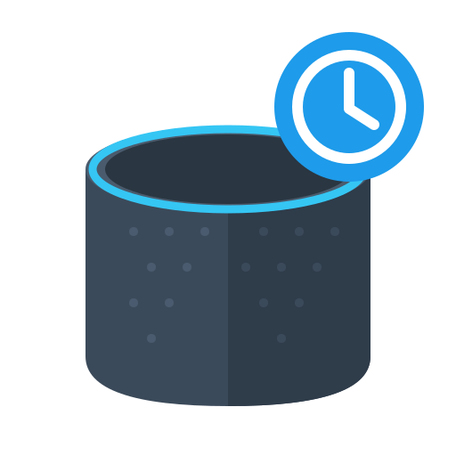

# Irabelle Alexa Last Called

[](https://my.home-assistant.io/redirect/hacs_repository/?owner=notf0und&repository=irabelle-alexa-last-called&category=integration)

<p align="center"></p>

A Home Assistant integration that tells you **which Echo device you spoke to last**. Use it to answer
on the speaker you just talked to, or to know which room someone is in.

It listens to the Amazon voice history through the same push channel the Alexa app uses, so the
sensor updates within a moment of you speaking to an Echo, and a light periodic sync catches anything missed.

## Installation

1. Click the button above, or in HACS add `https://github.com/notf0und/irabelle-alexa-last-called` as a custom repository (type *Integration*), then download **Irabelle Alexa Last Called**.
2. Restart Home Assistant.
3. **Settings → Devices & services → Add integration → Irabelle Alexa Last Called**.
4. Enter your Amazon account e-mail, password and a one-time code from an authenticator app (OTP).
   Only OTP-app codes are supported. The login can take a few minutes.

Or manually: copy `custom_components/irabelle_alexa_last_called/` into your `config/custom_components/`.

## Sensor

`sensor.alexa_last_called`: the state is the name of the Echo device that was spoken to last.

| Attribute | Description |
| --- | --- |
| `serial_number` | Serial number of that device |
| `last_called_at` | When it was called (ISO timestamp) |
| `voice_command` | What you said |
| `voice_reply` | What Alexa answered |
| `intent` | The intent Amazon recognised |

## Example

Pick the speaker you last talked to (the state is the device's name in the Alexa app, so map it to your
own `media_player` entities):

```yaml
variables:
  target_device: >
    
    {{ devices.get(states('sensor.alexa_last_called'), 'media_player.kitchen_echo_show') }}
```

Only react to a request made in the last minute:

```yaml
condition:
  - condition: template
    value_template: >
      {{ now().timestamp() - as_timestamp(state_attr('sensor.alexa_last_called', 'last_called_at')) < 60 }}
```

## Migrating from the old `alexa_last_called`

Keep the config entry and entity: stop Home Assistant, change the entry's `domain` to
`irabelle_alexa_last_called` in `.storage/core.config_entries` and the entity's `platform` in
`.storage/core.entity_registry`, replace the old `custom_components/alexa_last_called` folder with this
one and start Home Assistant again. `sensor.alexa_last_called` and the automations using it keep working.

## License

MIT
